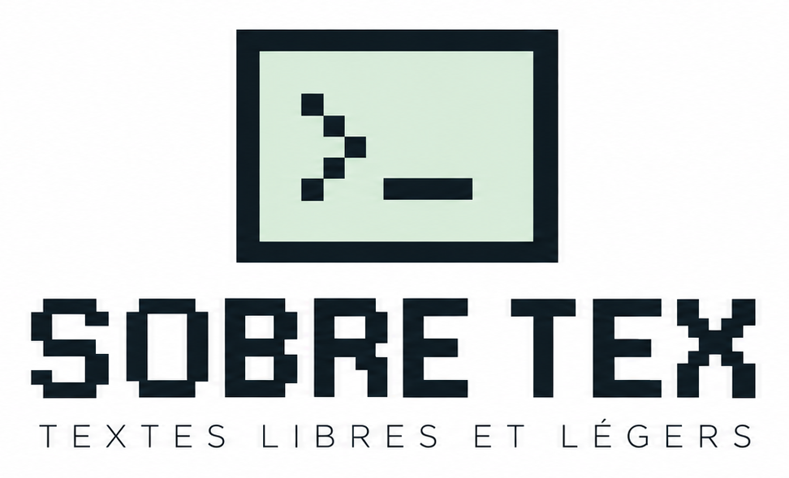

<p align="center">
  
</p>

# Sobre TeX

**Un éditeur LaTeX à balisage, pensé pour les Noobs qui veulent devenir Geeks.**

Sobre TeX est le premier logiciel de la gamme **Sobre** (*logiciels libres et légers*). C'est un éditeur LaTeX graphique au style Mac 1-bit des années 1990. On y colle du texte brut, on sélectionne un passage, puis on clique sur un style : la balise LaTeX s'écrit toute seule, en couleur. La mise en forme se règle visuellement dans une feuille de style, comme dans un traitement de texte, et Sobre TeX en déduit le code LaTeX.

> Version 0.1, premier jet destiné à tester et à amender l'ergonomie.
> © 2026 Auraponymous

---

## Pourquoi

Pour un néophyte, LaTeX demande un apprentissage raide : il faut connaître les commandes, écrire le préambule et protéger les caractères spéciaux. Les éditeurs « WYSIWYG » qui cachent le code n'apprennent rien et cassent souvent les allers-retours.

Sobre TeX choisit une voie intermédiaire :

- **le code reste visible**, avec des balises colorées par famille, si bien qu'on apprend LaTeX en le voyant s'écrire ;
- **la mise en forme se règle visuellement** dans une feuille de style, qui écrit le préambule à la place de l'utilisateur ;
- **un aperçu à côté du code** montre le rendu au fil de la frappe.

Sobre TeX s'adresse aussi bien aux débutants (collègues non LaTeXiens qui doivent produire des documents propres) qu'aux habitués qui veulent aller vite.

---

## Démarrer

Sobre TeX tient dans **un seul fichier HTML**, sans installation et sans serveur.

1. Ouvrez `index.html` (ou `Sobre_TeX.html`) d'un double-clic dans votre navigateur.
2. La page d'accueil s'efface après 5 secondes, ou tout de suite au clic ou sur une touche.
3. Collez votre texte brut dans la fenêtre de code.
4. Sélectionnez un passage et cliquez sur un style dans la barre d'outils.
5. Enregistrez avec **Fichier › Enregistrer** (⌘S / Ctrl+S) pour obtenir un fichier `.tex` complet.
6. Pour obtenir le PDF, déposez le `.tex` sur [Overleaf](https://www.overleaf.com) ou compilez-le avec une installation LaTeX locale (`pdflatex`).

Le fichier fonctionne aussi depuis une clé USB ou une fois hébergé sur GitHub Pages. Les polices viennent de Google Fonts : hors ligne, l'application reste fonctionnelle avec des polices de remplacement.

Pour une démonstration, ouvrez **Aide › Document d'exemple**.

---

## L'interface

```
┌─ Barre de menus ── Fichier · Édition · Affichage · Style · Fenêtre · Aide ──────── ? ─┐
├─ Barre d'outils ──────────────────────────────────────────────────────────────────────┤
│ [Styles] [menu ▼] [styles en pictos] | G I S abc | alignements | insertion | 👁 | 17:42 │
├─ Fenêtre de code ────────────────────────┬─ Aperçu ────────────────────────────────────┤
│ règle · préambule replié · code coloré   │ page A4 approchée, mise à jour en direct    │
│ barre d'état : sélection · balise · pos. │ nombre de pages · zoom                       │
└──────────────────────────────────────────┴─────────────────────────────────────────────┘
```

- Les **deux fenêtres** se déplacent par leur barre de titre, se redimensionnent par le coin et s'agrandissent par la case de droite. **Fenêtre › Réinitialiser la disposition** les remet en place. Sur un écran étroit, elles s'empilent.
- Le **défilement est synchronisé** entre le code et l'aperçu, bloc par bloc. On peut le couper dans **Affichage**.
- Au survol, chaque bouton affiche une **bulle jaune** avec son nom et son raccourci. Le bouton **?** active les bulles détaillées, qui montrent la commande LaTeX écrite par le bouton.
- Le **témoin de sauvegarde**, en fin de barre d'outils, affiche l'heure de la dernière sauvegarde automatique : blanc sur vert quand tout va bien, blanc sur rouge en cas d'échec.

### Barre d'outils, de gauche à droite

| Groupe | Contenu |
|---|---|
| Styles | Bouton **Styles** (ouvre la feuille de style), menu déroulant du style de paragraphe, un picto par style |
| Mise en forme directe | **G** gras, *I* italique, <u>S</u> souligné, ~~abc~~ barré |
| Alignement | Drapeau gauche, centré, drapeau droite, au bloc |
| Insertion | Tableau, image, saut de page |
| Affichage | 👁 aperçu, puis le témoin de sauvegarde |

---

## Les styles

### Styles par défaut

| Style | Code LaTeX | Couleur de la balise |
|---|---|---|
| Titre général | `\titre{…}` (défini dans le préambule) | rouge |
| Titre 1 | `\section{…}` | rouge |
| Titre 2 | `\subsection{…}` | rouge |
| Titre 3 | `\subsubsection{…}` | rouge |
| Corps de texte | texte sans balise | — |
| Citation | `\begin{quote} … \end{quote}` | vert |
| Encadré | `\encadre{…}` (style maison) | orange |
| Liste à puces | `\begin{itemize} \item … \end{itemize}` | vert |
| Liste numérotée | `\begin{enumerate} \item … \end{enumerate}` | vert |
| Note de bas de page | `\footnote{…}` | violet |

La mise en forme directe (gras `\textbf`, italique `\textit`, souligné `\uline`, barré `\sout`) apparaît en **bleu**. Les alignements directs (`flushleft`, `center`, `flushright`, `justify`) apparaissent en **vert**.

### Comment s'appliquent les styles

- **Titres** : ils s'appliquent à toute la ligne du curseur. Un titre tient sur une seule ligne.
- **Listes** : chaque ligne sélectionnée devient un `\item`. Les puces collées (`-`, `•`, `1.`) sont nettoyées. Un clic sur l'autre type de liste convertit la liste.
- **Styles de caractère** : ils entourent la sélection. Une sélection qui coupe une balise ou s'étend sur plusieurs paragraphes est refusée, avec une explication.
- **Second clic** : un deuxième clic sur le même style retire la balise.
- **Annulation** : tout s'annule avec ⌘Z / Ctrl+Z.

### La feuille de style

Le bouton **Styles** ouvre la feuille de style. Pour chaque style, on règle :

- la police (comme le corps de texte, romain, linéale, machine à écrire) ;
- la taille ;
- le gras et l'italique ;
- la couleur, parmi une palette franche : noir, rouge, bleu, vert, orange, violet, jaune ;
- l'alignement : drapeau gauche, centré, drapeau droite, au bloc ;
- l'espace avant et l'espace après ;
- l'encadrement, pour les styles maison de paragraphe.

Le **Corps de texte** porte la police du document (Latin Modern, Times, Palatino, Latin Modern Sans, Helvetica, Latin Modern Mono), sa taille (10, 11 ou 12 pt), l'espace entre paragraphes et l'alinéa.

La boîte de dialogue montre un exemple du style et le code LaTeX généré. On peut créer des **styles maison**, de paragraphe ou de caractère : le nom de la commande est déduit du nom du style, par exemple « Chiffre clé » donne `\chiffrecle`.

**Mise en page** règle le format (A4, A5, Lettre US), les marges, la langue (français ou anglais) et la numérotation des titres.

Une charte se **partage** : **Style › Exporter la charte…** produit un fichier `.sobre.json`, que les collègues importent pour obtenir exactement les mêmes styles. **Style › Rétablir la charte par défaut…** revient aux réglages d'origine.

---

## Le préambule

Un fichier `.tex` a deux parties :

```latex
\documentclass[11pt,a4paper]{article}   % ← préambule : les réglages
\usepackage[french]{babel}
\titleformat{\section}{…}
\newcommand{\encadre}[1]{…}

\begin{document}                        % ← document : le texte balisé
\section{Le principe}
…
\end{document}
```

Le **préambule** est le terme LaTeX officiel. Dans Sobre TeX, il est **entièrement généré par la feuille de style** : la fenêtre de code ne montre que le document, et la barre « ▸ Préambule (N lignes)… Voir » permet de consulter le code généré.

Paquets utilisés : `inputenc`, `fontenc`, `babel`, `lmodern` (plus `mathptmx`, `mathpazo` ou `helvet` selon la police), `geometry`, `graphicx`, `ulem`, `ragged2e`, `xcolor`, `titlesec`, `etoolbox`.

---

## Caractères spéciaux

Les caractères `% & $ # _ { } ~ ^ \` cassent la compilation LaTeX s'ils ne sont pas protégés. Sobre TeX les protège **automatiquement** :

- **au collage** : `50 %` devient `50 \%`, et la barre d'état indique combien de caractères ont été protégés ;
- **à la frappe**, pour `% & $ # _`.

Les caractères protégés s'affichent en **gris pointillé** dans le code. Un caractère spécial non protégé est surligné en rouge, dans le code comme dans l'aperçu.

Du code copié depuis Sobre TeX lui-même et recollé n'est pas protégé une seconde fois. Les deux protections se désactivent dans le menu **Édition**, par exemple pour coller du LaTeX brut.

---

## Enregistrement et sécurité

| Mécanisme | Rôle |
|---|---|
| **Fichier › Enregistrer** (⌘S) | Produit le `.tex` complet (préambule, document, feuille de style). C'est la seule vraie sauvegarde. |
| Sauvegarde automatique | Après chaque modification, le document est gardé dans le navigateur. Le témoin affiche l'heure. |
| Récupération au lancement | Si Sobre TeX a été fermé sans enregistrer (plantage, onglet fermé), il propose au démarrage : « Un document non enregistré a été retrouvé… [Ignorer] [Récupérer] ». Sinon, il s'ouvre sur une page vierge, comme Word. |
| Alerte de fermeture | Si le `.tex` n'est pas enregistré, le navigateur demande confirmation avant de fermer l'onglet (quand il l'autorise). |
| Fermer / Quitter | Dans le menu Fichier, avec la question « Ne pas enregistrer / Annuler / Enregistrer ». |

Le fichier `.tex` enregistré contient en commentaire une ligne `% SOBRE-STYLE: {…}`. Elle permet de rouvrir le document **avec sa feuille de style**. Un `.tex` venu d'ailleurs s'ouvre aussi, mais son préambule d'origine est remplacé par la charte courante.

---

## Raccourcis clavier

Sobre TeX affiche ⌘ sur Mac et Ctrl sur Linux et Windows.

| Action | Mac | Linux / Windows |
|---|---|---|
| Gras | ⌘B | Ctrl+B |
| Italique | ⌘I | Ctrl+I |
| Souligné | ⌘U | Ctrl+U |
| Titre 1 / 2 / 3 | ⌥⌘1 / 2 / 3 | Ctrl+Alt+1 / 2 / 3 |
| Corps de texte | ⌥⌘0 | Ctrl+Alt+0 |
| Enregistrer | ⌘S | Ctrl+S |
| Ouvrir | ⌘O | Ctrl+O |
| Imprimer l'aperçu (version fichier) | ⌘P | Ctrl+P |
| Annuler / Rétablir | ⌘Z / ⇧⌘Z | Ctrl+Z / Ctrl+Y |

Fermer et Quitter n'ont **pas** de raccourci. ⌘W, ⌘Q, Ctrl+W et Alt+F4 appartiennent au navigateur ou au système, et aucune page web ne peut les intercepter. La récupération au lancement couvre ce cas.

---

## Choix techniques

- **Un seul fichier HTML autonome** : HTML, CSS et JavaScript sans bibliothèque ni étape de compilation. Seules les polices viennent de Google Fonts (Pixelify Sans, Silkscreen, IBM Plex Mono et Sans, STIX Two Text, Tinos, Arimo).
- **Éditeur coloré** : une zone de texte transparente est posée sur un calque qui redessine la coloration. La sélection, le copier-coller et l'annulation natifs du navigateur sont donc conservés.
- **Aperçu** : un traducteur du sous-ensemble LaTeX utilisé produit du HTML, mis en forme par une CSS générée à partir de la même feuille de style que le préambule. Une seule source pilote les deux sorties.
- **Stockage** : `localStorage` du navigateur, pour le document en cours, la charte, les préférences et la disposition.
- **Code organisé par blocs** : lecture du LaTeX, préambule, aperçu, édition, fenêtres, dialogues, fichiers, menus. L'accès aux fichiers est isolé, ce qui prépare le passage en application de bureau.

---

## Limites connues (V0.1)

- **Aperçu approché** : il ne remplace pas la compilation. La pagination est continue, avec des repères de page. Les sauts de page explicites sont respectés, mais pas la coupure automatique des pages.
- **Notes de bas de page** : l'aperçu les regroupe en fin de document. Le PDF compilé les place bien en bas de leur page.
- **Équations** : elles s'insèrent et se compilent, mais l'aperçu les montre en cadre gris, sans rendu mathématique.
- **Tableaux et images** : ils s'insèrent par modèle de code. L'aperçu affiche les tableaux simples, et un cadre à la place des images.
- **Un seul document à la fois** dans la sauvegarde automatique, et dans un seul navigateur. Le comportement de Firefox avec un fichier local déplacé reste à vérifier.
- **Lien de test hébergé** : il ne peut pas télécharger de `.tex` (copie du code ou export `.txt` à la place) et le navigateur peut y ignorer l'alerte de fermeture. La version fichier n'a pas ces limites.
- **Compilation** : le préambule généré (titre général, polices, alignements, `ulem`, `ragged2e`) reste à **valider sur Overleaf**.

---

## Feuille de route

- [ ] Rajouter la possibilité d'export vers .docx ou .odt
- [ ] Valider la compilation du préambule généré sur Overleaf et TeX Live.
- [ ] Notes de bas de page placées en bas de leur page dans l'aperçu.
- [ ] Rendu des équations dans l'aperçu.
- [ ] Historique des versions automatiques (par exemple une toutes les 5 minutes).
- [ ] Version installable (PWA) : icône, fenêtre dédiée, hors ligne.
- [ ] **Application de bureau Tauri** (macOS, Windows, Linux) :
  - vrais fichiers sur le disque ;
  - raccourcis natifs (⌘W/Ctrl+W, ⌘Q/Ctrl+Q) avec « Enregistrer avant de fermer ? » ;
  - **compilation PDF intégrée** avec le moteur Tectonic, l'aperçu devenant alors le vrai PDF.
- [ ] Choisir et publier une licence libre (l'EUPL est envisagée).

## Licence

Licence libre **EUPL est envisagée**.
© 2026 **Auraponymous**.
